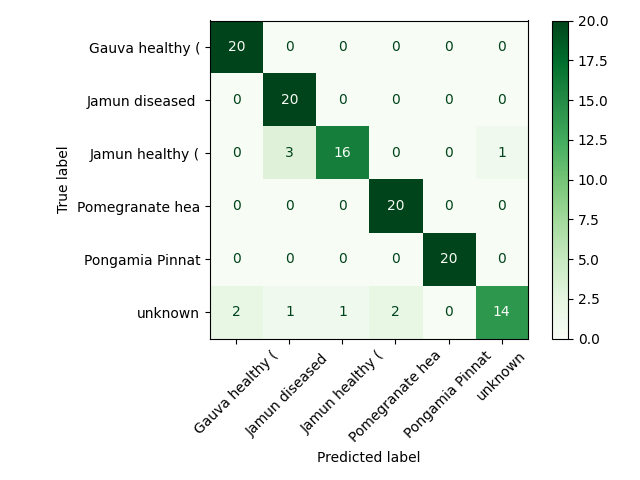

# Leaf Classification with an "Unknown" Class

A beginner-friendly computer vision project that classifies leaf photos into **5 known classes plus an "unknown" class**, using transfer learning (MobileNetV2) and a Random Forest.

---

## 1. Project Overview

- **Goal:** classify a leaf photo into one of five known classes, or say "unknown" if it does not match any of them.
- **Approach:** pretrained MobileNetV2 extracts image features, and a Random Forest classifies them.
- **Unknown class:** handled in two ways: (1) training examples from other leaf folders, and (2) a confidence threshold at prediction time.

## 2. Dataset

- **Source:** [Plant Leaves for Image Classification](https://www.kaggle.com/datasets/csafrit2/plant-leaves-for-image-classification) (Kaggle, `csafrit2`)
- **Download:** done automatically in the code with `kagglehub`. The full dataset is not stored in this repo because of its size.
- **Known classes:** the five largest folders: `<FILL IN: list your 5 classes from outputs/results.json>`
- **Unknown class:** images sampled from all the other folders.
- **Size used:** up to 100 images per class.
- **Metadata:** `outputs/metadata.csv` lists every image path, original folder name, and final label.

## 3. Repository Structure

```
.
├── leaf_classification.ipynb    # main notebook (same code as the .py file)
├── leaf_classification.py       # same code as a script
├── requirements.txt
├── README.md
├── sample_images/               # 3 example photos per class
└── outputs/
    ├── metadata.csv
    ├── results.json             # all metrics
    ├── class_counts.png
    ├── image_sizes.png
    ├── color_distribution.png
    ├── montage.png
    ├── confusion_matrix.png
    └── confusion_matrix_threshold.png
```

## 4. Exploratory Data Analysis (EDA)

| Plot | What it shows |
|---|---|
| `class_counts.png` | Number of images in each class |
| `image_sizes.png` | Width and height of the photos |
| `color_distribution.png` | Mean red, green and blue values per class |
| `montage.png` | Sample photos from each class |

**Observations:** `The dataset contains five selected leaf classes and an additional unknown class. The class counts and image dimensions were examined to assess class balance and variation in image sizes. Sample images and colour distributions were also inspected to identify visual similarities between classes that could contribute to misclassification.`
From class_counts.png, image_sizes.png, color_distribution.png and montage.png, we can obtain the required analysis.

## 5. Method

1. **Metadata:** build a CSV of images and labels.
2. **Preprocessing:** resize to 224×224, scale pixels to [-1, 1] (MobileNetV2 normalization).
3. **Split:** 80% train and 20% test, stratified by class.
4. **Features:** MobileNetV2 (ImageNet weights, no top layer, average pooling) gives a 1280-value vector per image.
5. **Classifier:** Random Forest with 300 trees trained on those features.
6. **Unknown handling:**
   - an explicit "unknown" class built from other leaf folders
   - a confidence threshold of 0.5: if the highest class probability is below it, predict "unknown"

## 6. Results

| Metric | Without threshold | With threshold (0.5) |
|---|---|---|
| Accuracy | `0.917` | `0.842` |
| Macro-F1 | `0.913` | `0.850` |

**Per-class recall**

| Class | Recall |
|---|---|
| `<class 1>` | `1.00` |
| `<class 2>` | `1.00` |
| `<class 3>` | `0.80` |
| `<class 4>` | `1.00` |
| `<class 5>` | `1.00` |
| unknown | `0.70` |



## 7. Discussion: What Gets Confused and Why

The most frequent confusion among known classes occurred between Jamun healthy (P5a) and Jamun diseased (P5b), with three healthy Jamun samples classified as diseased. This may be due to similarities in leaf colour, shape, texture, or visible surface features.

The unknown class was correctly classified in 14 out of 20 cases (recall = 0.70), while six unknown samples were classified as one of the five known classes. These errors indicate that the model sometimes assigns unfamiliar leaf images to a known category.

Without the confidence threshold, the model achieved an accuracy of 0.917 and a macro-F1 score of 0.913. Applying the threshold of 0.5 reduced accuracy to 0.842 and macro-F1 to 0.850. This illustrates a trade-off between accepting known-class predictions and rejecting uncertain samples as unknown. Further analysis of the thresholded confusion matrix is needed to determine whether the threshold improves unknown-class detection.

## 8. Limitations

- Small dataset (up to 100 images per class), so results can change with a different random split.
- The "unknown" class only contains leaves from this dataset. Completely different objects (for example a hand or a table) are not covered.
- Photos in this dataset may have clean backgrounds, so real-world phone photos may perform worse.
- Frozen features were used, with no fine-tuning of MobileNetV2.

## 9. Possible Extensions

- Fine-tune MobileNetV2 or try ResNet.
- Compare with a beginner model using hand-made color, texture and shape features with SVM.
- Classify healthy vs unhealthy leaves.
- Add photos of local tree species taken with a phone.

## 10. How to Run

**Google Colab (easiest)**
1. Upload `leaf_classification.ipynb` to Colab.
2. Uncomment the `!pip install` line in the first cell and run it.
3. Run all cells. Colab can download the Kaggle dataset through `kagglehub`.

**Locally**
```bash
pip install -r requirements.txt
python leaf_classification.py
```
Outputs are saved to `outputs/` and `sample_images/`.

**Predict your own photo:** use the `predict_photo("my_leaf.jpg")` function at the end of the notebook. It returns the predicted class and confidence.

## 11. Tools Used

Python, TensorFlow/Keras (MobileNetV2), scikit-learn (Random Forest and metrics), pandas, matplotlib, Pillow, kagglehub.

## 12. Credits

- Dataset: Kaggle, [csafrit2/plant-leaves-for-image-classification](https://www.kaggle.com/datasets/csafrit2/plant-leaves-for-image-classification)
- Pretrained model: MobileNetV2 (ImageNet weights, via Keras)
